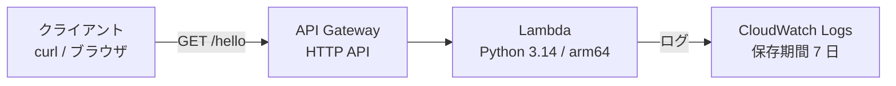

# aws-lambda-minimal

AWS Lambda と Amazon API Gateway（HTTP API）で作る、最小構成の Web API のサンプル。
インフラは AWS SAM で定義していて、コマンド数個でデプロイと削除ができる。Docker は使わない。

`GET /hello?name=xxx` に対して、次の JSON を返す（`name` がない場合は `World`）。

```json
{"message": "Hello, xxx!"}
```

AWS アカウントの作成から後片付けまでの詳しい手順は、[docs/getting-started.md](docs/getting-started.md) にある。手順書の冒頭の「全体の流れ」に、各章で何をするか、何のためかを表でまとめている。
用語の意味と、使う AWS のサービスやコマンドの役割は、勉強用の資料 [docs/how-it-works.md](docs/how-it-works.md) にある（お店にたとえて説明している）。手順書には手順だけを書いている。

## 構成



| リソース | 設定 |
|---|---|
| Lambda | Python 3.14、arm64、メモリ 128 MB、タイムアウト 10 秒、zip 形式 |
| API Gateway | HTTP API、`GET /hello`、認証なし |
| CloudWatch Logs | ロググループの保存期間 7 日（Lambda が自動で作るロググループは無期限に残るため、テンプレートで作る） |

## ファイル構成

```
.
├── src/
│   └── app.py              # Lambda ハンドラ（標準ライブラリのみ）
├── tests/
│   └── test_app.py         # pytest による単体テスト（AWS に接続しない）
├── docs/
│   ├── getting-started.md  # 手順書（手順だけ）
│   ├── how-it-works.md     # 勉強用の資料（用語集と仕組みの説明）
│   └── terraform.md        # Terraform のメモ（SAM との違い）
├── template.yaml           # SAM テンプレート
├── requirements-dev.txt    # 開発用の依存（pytest）
├── samconfig.toml          # sam deploy の設定（スタック名、リージョンなど）
├── LICENSE                 # MIT License
└── .gitignore
```

## 前提

- AWS アカウント（手順書の 2〜4 章。手順書は 2026 年 9 月に始まった新しい登録方式（プロジェクト方式）を前提にしている）
- AWS CLI 2.32.0 以上（`aws login` を使うため）
- AWS SAM CLI
- Python 3.14（Lambda のランタイムと同じバージョン。`sam build` が確かめる）

## クイックスタート

コードのブロックはコマンドだけで、そのまま貼り付けて実行できる。

1. テスト

   ```bash
   python3.14 -m venv .venv
   source .venv/bin/activate
   pip install -r requirements-dev.txt
   pytest
   ```

2. AWS にログイン（ブラウザが開く。リージョンはプロジェクトのリージョン）

   ```bash
   aws login
   aws sts get-caller-identity
   ```

3. ビルドとデプロイ（詳細は手順書の 7 章）

   ```bash
   sam build
   sam deploy
   ```

   `samconfig.toml` のリージョンは `ap-southeast-2`。プロジェクトのリージョンが違う場合は、`sam deploy` の代わりに `sam deploy --guided` を実行し、質問に答えて設定を作り直す。

4. 動作確認（デプロイで作られた API の URL を取り出して呼び出す）

   ```bash
   URL=$(aws cloudformation describe-stacks --stack-name aws-lambda-minimal --query "Stacks[0].Outputs[?OutputKey=='HelloApiUrl'].OutputValue" --output text)
   curl "$URL?name=test"
   ```

   `{"message": "Hello, test!"}` が返る。

5. 削除

   ```bash
   sam delete
   ```

## 費用の目安

2026 年 10 月時点の AWS 公式の料金ページの情報。

| サービス | 無料枠 |
|---|---|
| Lambda | 毎月 100 万リクエストと 40 万 GB 秒 |
| API Gateway（HTTP API） | 毎月 100 万回の呼び出し（料金ページの記載では最大 12 か月） |
| CloudWatch Logs | 毎月 5 GB（取り込み、アーカイブ保存、Logs Insights のスキャンの合計） |
| AWS Budgets | 予算の監視と通知は無料 |

- 動作確認で数十回呼び出す程度であれば、いずれも無料枠の範囲に収まる。
- Free プランでは請求は発生せず、利用料は新規登録時のクレジット（最大 200 USD）から差し引かれる。Paid プランでも、クレジットが先に利用料に充てられる。
- API Gateway の URL は認証なしで公開されるため、使い終わったら `sam delete` で削除する。
- `sam deploy` が作る SAM 用の S3 バケットは `sam delete` では消えない。消し方は手順書の 10 章にある。

参考:
[AWS Lambda の料金](https://aws.amazon.com/lambda/pricing/) /
[Amazon API Gateway の料金](https://aws.amazon.com/api-gateway/pricing/) /
[Amazon CloudWatch の料金](https://aws.amazon.com/cloudwatch/pricing/) /
[AWS Budgets の料金](https://aws.amazon.com/aws-cost-management/aws-budgets/pricing/) /
[AWS Free Tier](https://aws.amazon.com/free/)

## 次のステップ

- **コンテナ版の Lambda**: 同じ関数を Docker イメージにして Amazon ECR に置き、Lambda から使う（`PackageType: Image`）
- **GitHub Actions による自動デプロイ**: GitHub の OIDC と IAM ロールを使い、アクセスキーを GitHub に保存せずに、main ブランチへの push で `sam deploy` を実行する
- **Terraform 版**: 同じ構成を Terraform で書き、SAM（CloudFormation）との違いを比べる（下調べは [docs/terraform.md](docs/terraform.md)）
